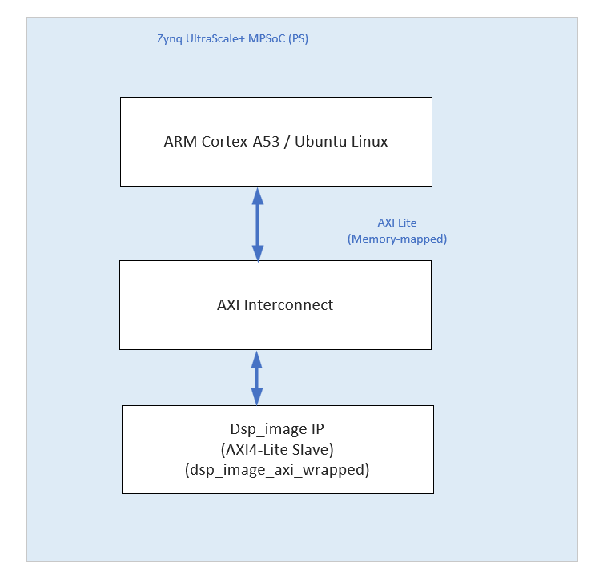
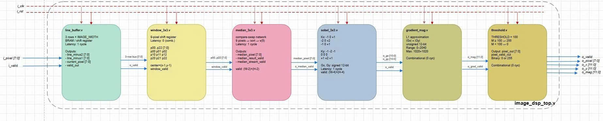
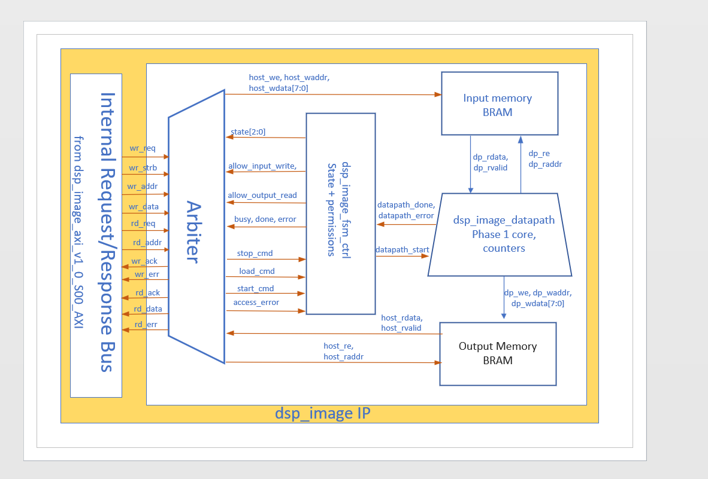
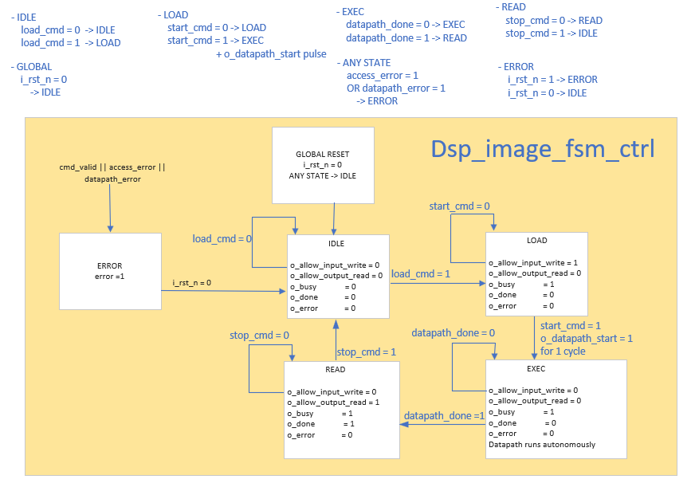
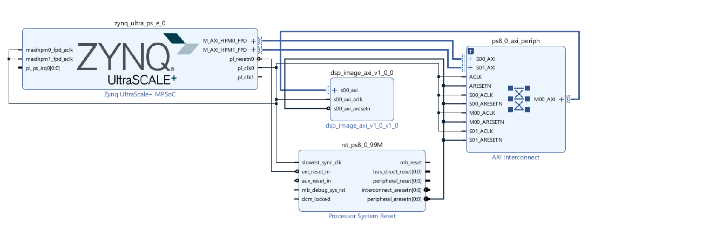
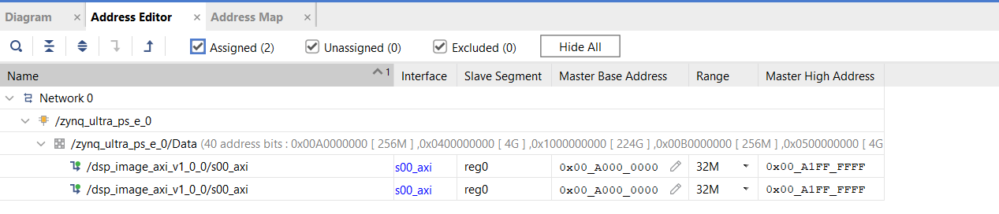

# Median-Sobel Image Processing Accelerator on FPGA SoC

<p align="center">
  <b>Streaming RTL Image Processing · AXI4-Lite SoC Integration · AMD Kria KR260 · Linux MMIO · Python / ARM C / FPGA Verification</b>
</p>

<p align="center">
  
  
  
  
  
  
</p>

---

## Overview

This project implements a complete **Median-Sobel image-processing accelerator** on an FPGA SoC platform.

The system combines:

- deterministic Python golden-model generation;
- native ARM C software execution;
- synthesizable Verilog-2001 RTL;
- streaming 3x3 neighborhood processing;
- Median filtering for salt-and-pepper noise removal;
- Sobel edge detection;
- AXI4-Lite memory-mapped accelerator control;
- Ubuntu Linux userspace MMIO;
- physical deployment on the AMD Kria KR260;
- repeated Python / ARM C / FPGA correctness and timing experiments.

The hardware accelerator is implemented in the Programmable Logic of the Kria K26 SoM, while Ubuntu Linux running on the ARM Cortex-A53 Processing System controls it through AXI4-Lite.

<p align="center">
  
</p>

<p align="center">
  <i>System-level hardware/software architecture on the AMD Kria KR260.</i>
</p>

---

# Project Highlights

## FPGA Image-Processing Pipeline

```text
RGB Image
    |
    v
Grayscale
    |
    v
Salt & Pepper Noise
    |
    v
Median 3x3
    |
    v
Sobel 3x3
    |
    v
|Gx| + |Gy|
    |
    v
Threshold >= 100
    |
    v
Binary Edge Image
```

Offline preprocessing uses deterministic integer arithmetic:

```text
Y = (77R + 150G + 29B) >> 8

salt-and-pepper probability = 5%
random seed                = 12345
```

The FPGA receives the already generated noisy grayscale frame.

The final valid region is:

```text
x = 2 ... W-3
y = 2 ... H-3

N_INPUT  = W * H
N_OUTPUT = (W - 4) * (H - 4)
```

Current physical KR260 configuration:

```text
Input resolution = 64 x 64
Input pixels     = 4096
Valid outputs    = 3600
Threshold        = 100
PL clock         = 100 MHz
```

---

# Phase 1 — Streaming Image DSP Core

**Status: VERIFIED AND FROZEN**

```text
image_dsp_top
|
+-- line_buffer #1
+-- window_3x3 #1
+-- median_3x3
+-- line_buffer #2
+-- window_3x3 #2
+-- sobel_3x3
+-- gradient_mag
+-- threshold
```

<p align="center">
  
</p>

<p align="center">
  <i>Phase 1 streaming Median-Sobel datapath.</i>
</p>

### Verified RTL Results

| Resolution | Input pixels | Valid outputs | Mismatches | Result |
|---|---:|---:|---:|---|
| 64x64 | 4,096 | 3,600 | 0 | PASS |
| 512x512 | 262,144 | 258,064 | 0 | PASS |
| 640x480 | 307,200 | 302,736 | 0 | PASS |

A two-frame 512x512 regression also completed with zero errors.

### Registered Pipeline Latency

| Stage | Latency |
|---|---:|
| Line Buffer 1 | 1 clk |
| Window Generator 1 | 0 clk |
| Median 3x3 | 1 clk |
| Line Buffer 2 | 1 clk |
| Window Generator 2 | 0 clk |
| Sobel 3x3 | 1 clk |
| Magnitude + Threshold | 0 clk |
| **Total registered latency** | **4 clk** |

The Median filter uses a nine-stage **combinational** odd-even compare-swap network followed by one output register.

The nine sorting stages are not nine clock cycles.

---

# Phase 2 — Processor-Controlled Accelerator

**Status: RTL + AXI SIMULATION VERIFIED**

<p align="center">
  
</p>

<p align="center">
  <i>Processor-controlled Phase 2 accelerator architecture.</i>
</p>

RTL hierarchy:

```text
dsp_image_axi_v1_0
|
+-- dsp_image_axi_v1_0_S00_AXI
    |
    +-- dsp_image_top
        |
        +-- dsp_image_arbiter
        +-- dsp_image_fsm_ctrl
        +-- dsp_image_input_memory
        +-- dsp_image_datapath
        |   |
        |   +-- image_dsp_top
        |
        +-- dsp_image_output_memory
```

Phase 2 provides:

- frame storage;
- processor access control;
- accelerator state management;
- Phase 1 reset and execution control;
- dense result capture;
- AXI4-Lite software access.

**DMA is not used in the current implementation.**

---

# Phase 2 Control FSM

```text
IDLE
  |
  | LOAD
  v
LOAD
  |
  | START
  v
EXEC
  |
  | datapath_done
  v
READ
  |
  | STOP
  v
IDLE
```

<p align="center">
  
</p>

<p align="center">
  <i>Phase 2 accelerator control FSM.</i>
</p>

Invalid commands, illegal accesses, or datapath errors enter a sticky `ERROR` state.

The Datapath uses a separate internal FSM:

```text
ST_IDLE
  ->
ST_PREP
  ->
ST_RUN
  ->
ST_COMMIT
  ->
ST_DONE
```

`ST_PREP` resets the Phase 1 core for one complete clock cycle before every frame.

---

# AXI4-Lite Interface

```text
AXI data width       = 32 bits
local address width  = 25 bits
IP aperture          = 32 MiB
pixel width          = 8 bits
pixel address stride = 4 bytes
DMA                  = not used
```

Input and CTRL writes require:

```text
WSTRB = 4'b0001
```

### Logical Address Map

| Offset | Register / Region | Function |
|---:|---|---|
| `0x00000000` | CTRL | Command register |
| `0x00000004` | STATUS | Accelerator status |
| `0x00000008` | INFO_WIDTH | Image width |
| `0x0000000C` | INFO_HEIGHT | Image height |
| `0x00000010` | INFO_THRESHOLD | Threshold |
| `0x00100000` | INPUT_BASE | Input frame |
| `0x01100000` | OUTPUT_BASE | Dense edge output |

---

# KR260 SoC Integration

The accelerator is integrated with:

```text
zynq_ultra_ps_e_0
ps8_0_axi_periph
rst_ps8_0_99M
dsp_image_axi_v1_0_0
```

<p align="center">
  
</p>

<p align="center">
  <i>Vivado PS-PL integration on the AMD Kria KR260.</i>
</p>

Physical accelerator aperture:

```text
Base address = 0xA0000000
High address = 0xA1FFFFFF
Range        = 32 MiB
```

<p align="center">
  
</p>

### Physical Addresses

| Function | Address |
|---|---:|
| CTRL | `0xA0000000` |
| STATUS | `0xA0000004` |
| INFO_WIDTH | `0xA0000008` |
| INFO_HEIGHT | `0xA000000C` |
| INFO_THRESHOLD | `0xA0000010` |
| INPUT_BASE | `0xA0100000` |
| OUTPUT_BASE | `0xA1100000` |

---

# Dense Output Mapping

Only the final valid Sobel region is stored in FPGA Output Memory.

For dense index `k`:

```text
x = 2 + (k % (IMAGE_WIDTH - 4))
y = 2 + (k / (IMAGE_WIDTH - 4))
```

For the current 64x64 frame:

```text
dense width   = 60
dense height  = 60
output pixels = 3600
```

Golden comparison uses:

```text
golden_index = y * IMAGE_WIDTH + x
```

---

# Verification

The verification hierarchy is:

```text
Python Golden Model
        |
        v
Module-Level RTL
        |
        v
Phase 1 Full-Frame RTL
        |
        v
Phase 2 Integration
        |
        v
AXI4-Lite End-to-End
        |
        v
Post-Route Implementation
        |
        v
Physical KR260
```

### Module-Level Results

| Component | Evidence | Result |
|---|---:|---|
| Line Buffer | 186 checks | PASS |
| Window Generator | 1,071 checks | PASS |
| Median Filter | 618 checks | PASS |
| Threshold | 8,204 checks | PASS |
| Sobel + Gradient | Integrated golden comparison | COVERED |

### Phase 2 / AXI Results

| Test | Result |
|---|---|
| Input Memory | 12,434 checks, 0 errors |
| Output Memory | 7,408 checks, 0 errors |
| Datapath 512x512 | 516,133 checks, 0 errors |
| FSM | 28 checks, 0 errors |
| Arbiter | 40 checks, 0 errors |
| Phase 2 512x512 | PASS |
| Phase 2 640x480 | PASS |
| Two-frame Phase 2 512x512 | PASS |
| AXI two-frame 64x64 | 24,041 checks, 0 errors |

AXI error regression also verifies:

```text
illegal write
    ->
SLVERR
    ->
sticky ERROR
    ->
active-low reset recovery
```

---

# Post-Implementation Results

Target:

```text
Device   : xck26-sfvc784-2LV
Vivado   : 2022.2
PL clock : 100 MHz
Period   : 10.000 ns
```

### Timing

| Metric | Result |
|---|---:|
| WNS | `+0.322 ns` |
| TNS | `0.000 ns` |
| WHS | `+0.013 ns` |
| THS | `0.000 ns` |
| Setup failing endpoints | `0` |
| Hold failing endpoints | `0` |
| Timing | **MET** |

Critical path:

```text
Source      : u_win1/p00_reg_reg[0]
Destination : u_median/o_median_reg[4]

Data delay  : 9.465 ns
Logic delay : 4.478 ns
Route delay : 4.987 ns
Logic levels: 24
Slack       : +0.322 ns
```

The Median sorting network is the dominant timing path but is **not a timing violation**.

### Resource Utilization

| Resource | Used | Available | Utilization |
|---|---:|---:|---:|
| CLB LUTs | 3,560 | 117,120 | 3.04% |
| LUT as Logic | 3,341 | 117,120 | 2.85% |
| LUT as Memory | 219 | 57,600 | 0.38% |
| CLB Registers | 3,406 | 234,240 | 1.45% |
| CARRY8 | 68 | 14,640 | 0.46% |
| BRAM Tiles | 2 | 144 | 1.39% |
| DSP slices | 0 | 1,248 | 0.00% |

### Power Estimate

```text
Total on-chip power = 2.737 W
Dynamic             = 2.437 W
Static              = 0.301 W
Junction temperature= 31.4 C
Confidence          = Medium
```

These are Vivado estimates rather than board-level measurements.

---

# KR260 Hardware Evaluation

Confirmed physical operations:

```text
FPGA bitstream load       PASS
FPGA manager              operating
INFO register reads       PASS
CTRL.LOAD                 PASS
Input MMIO writes         PASS
CTRL.START                PASS
READ/DONE reached         PASS
Output MMIO reads         PASS
CTRL.STOP                 PASS
```

Observed states:

```text
0x01 = IDLE
0x12 = LOAD + BUSY
0x38 = READ + BUSY + DONE
```

### Black-Frame Test

```text
3600 / 3600 outputs correct
```

### Python Golden Consistency

```text
4096 / 4096 values identical
0 numerical differences
```

---

# Native ARM C Baseline

The same Median-Sobel algorithm is implemented in native AArch64 C on the KR260 Cortex-A53.

| Metric | Result |
|---|---:|
| Correct runs | `20 / 20` |
| Mean | `4.817457 ms` |
| Median | `4.820223 ms` |
| Minimum | `4.753018 ms` |
| Maximum | `4.918889 ms` |
| Standard deviation | `0.040068 ms` |

---

# Current FPGA Debug Status

The noisy 64x64 FPGA result is not yet consistently bit-exact.

Across 20 repeated runs:

```text
Bit-exact runs = 5 / 20
Failing runs   = 15 / 20
Failure rate   = 75%
```

Every failing run contains exactly one mismatch:

| Dense index | Coordinate | FPGA | Golden |
|---:|---|---:|---:|
| `2306` | `(28,40)` | `0x00` | `0xFF` |

The failure is:

> **intermittent across executions but spatially deterministic whenever it occurs.**

Expected local Median output:

```text
A6 91 91
91 88 88
88 84 88
```

Expected Sobel result:

```text
Gx = -39
Gy = -65

M = |-39| + |-65|
  = 104

104 >= 100
```

Therefore:

```text
Expected output = 0xFF
```

Other locations with magnitude `104` produce correct FPGA outputs, so a simple global threshold bug is unlikely.

The Median network is a plausible timing-sensitive candidate because it is the post-route critical path, but static timing analysis still passes.

The root cause remains unconfirmed.

---

# FPGA Timing Measurement Status

The current Linux userspace observation gives:

```text
START-to-DONE mean = 23.008 us
```

However, the architecture must feed all 4096 pixels.

At 100 MHz:

```text
4096 cycles / 100 MHz
= 40.96 us
```

This lower bound does not yet include:

```text
ST_PREP
BRAM response
pipeline fill
pipeline flush
final output commit
READ transition
```

Therefore:

```text
23.008 us < 40.96 us
```

and the userspace measurement cannot currently represent the intended FPGA kernel latency.

It is retained only as diagnostic data.

Likewise:

```text
ARM C / FPGA ~= 209.40x
```

is **not a validated speedup result**.

A valid FPGA latency measurement requires:

- a hardware cycle counter; or
- ILA-based clock-cycle observation.

---

# Standalone Benchmark

The standalone benchmark package is located at:

```text
standalone_benchmark/
```

KR260 comparison:

```text
Python Golden
vs
ARM C
vs
FPGA RTL
```

Generated artifacts include:

```text
input.hex
golden_full.hex
golden_dense.hex
arm_output.hex
fpga_output.hex
fpga_console.log
result.json
```

Detailed setup and debugging instructions:

[`standalone_benchmark/README.md`](standalone_benchmark/README.md)

---

# Orange Pi Benchmark

Orange Pi support is prepared for:

```text
Python
vs
Native ARM C
```

Current status:

```text
software framework prepared
physical-board validation pending
```

Orange Pi does not control the KR260 FPGA.

---

# Repository Structure

```text
image-dsp-benchmark/
|
├── README.md
|
├── docs/
│   ├── SPEC_PHASE1.md
│   ├── SPEC_PHASE2.md
│   └── images/
│       ├── image_dsp_pipeline.png
│       ├── dsp_image_top_interface.png
│       ├── kr260_system_architecture.png
│       ├── dsp_image_phase2_architecture.png
│       ├── dsp_image_fsm.png
│       ├── kr260_vivado_block_design.png
│       └── kr260_address_map.png
|
├── python/
|
├── rtl/
|
├── tb/
|
├── fpga/
│   └── kr260/
|
├── software/
│   └── kr260/
│       └── main.c
|
├── standalone_benchmark/
│   ├── common/
│   ├── kr260/
│   ├── orangepi/
│   ├── scripts/
│   ├── static/
│   ├── templates/
│   └── README.md
|
├── data/
└── results/
```

---

# Current Project Status

| Area | Status |
|---|---|
| Python golden model | ✅ COMPLETE |
| Phase 1 streaming RTL | ✅ VERIFIED |
| Multi-resolution RTL simulation | ✅ PASS |
| Phase 2 accelerator | ✅ SIMULATION PASS |
| AXI4-Lite regression | ✅ PASS |
| Vivado implementation | ✅ COMPLETE |
| Routing | ✅ COMPLETE |
| 100 MHz timing | ✅ MET |
| KR260 MMIO communication | ✅ OPERATIONAL |
| KR260 black-frame test | ✅ PASS |
| Native ARM C | ✅ 20/20 PASS |
| Standalone KR260 benchmark | ✅ COMPLETE |
| KR260 noisy-frame correctness | 🟠 DEBUGGING |
| FPGA cycle-accurate latency | 🟠 NOT VALIDATED |
| CPU-to-FPGA speedup | 🟠 NOT VALIDATED |
| Orange Pi benchmark | ⏳ PENDING PHYSICAL TEST |
| DMA / AXI4-Stream | 🔵 FUTURE WORK |

---

# Locked Project Phase

```text
CURRENT PHASE:
PHYSICAL FPGA DEBUG + VALID PERFORMANCE MEASUREMENT
```

Immediate priorities:

1. Resolve the intermittent KR260 mismatch.
2. Obtain cycle-accurate FPGA START-to-DONE latency.
3. Validate the Orange Pi ARM C benchmark.

The current phase is complete only when:

```text
Repeated KR260 noisy-frame runs:
mismatch = 0

and

FPGA latency:
measured in PL clock cycles
```

Only then should a final CPU-to-FPGA speedup be reported.

DMA, AXI4-Stream, larger physical frames, and further architectural optimization are future work.

---

# Documentation

- [`docs/SPEC_PHASE1.md`](docs/SPEC_PHASE1.md) — frozen Phase 1 algorithm and RTL contract
- [`docs/SPEC_PHASE2.md`](docs/SPEC_PHASE2.md) — Phase 2 accelerator specification
- [`python/README.md`](python/README.md) — Python golden-model workflow
- `software/kr260/main.c` — Linux AXI MMIO controller
- [`standalone_benchmark/README.md`](standalone_benchmark/README.md) — KR260 / Orange Pi benchmark setup and debugging

---

# License

MIT License.