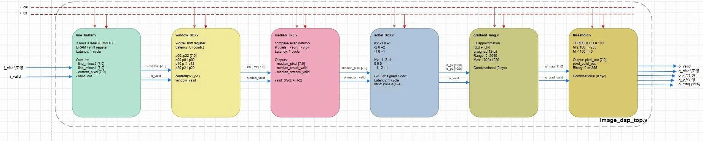
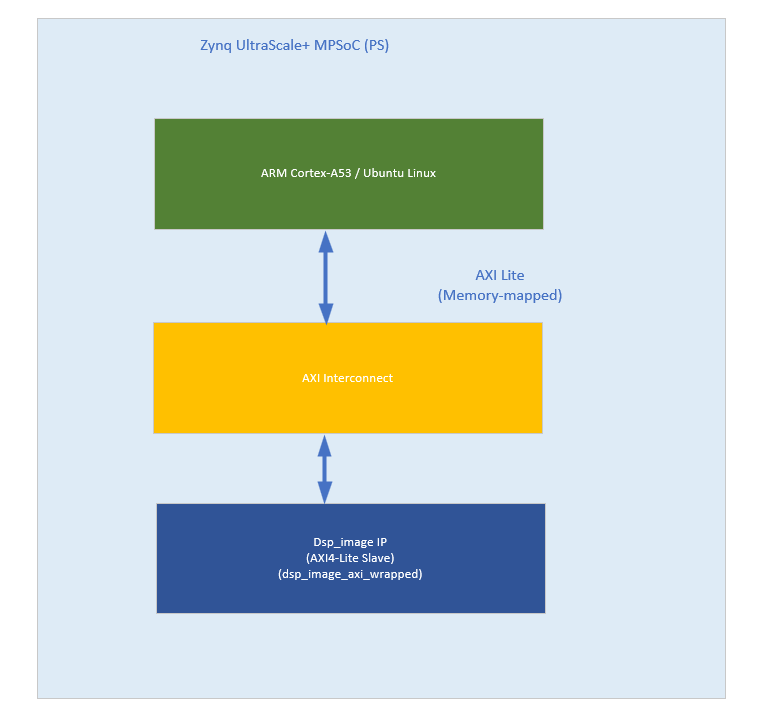
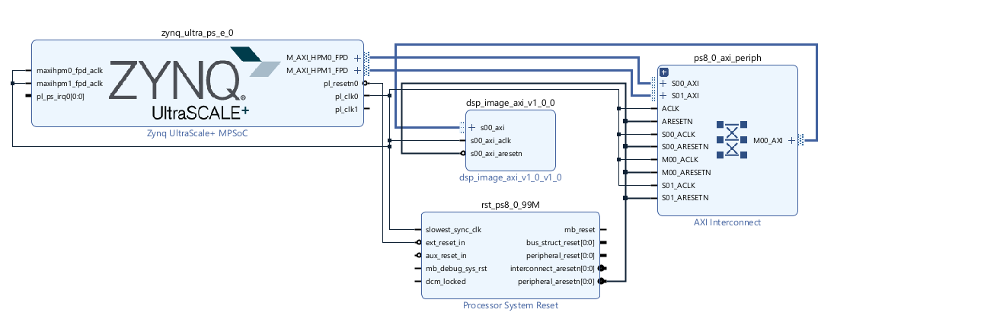
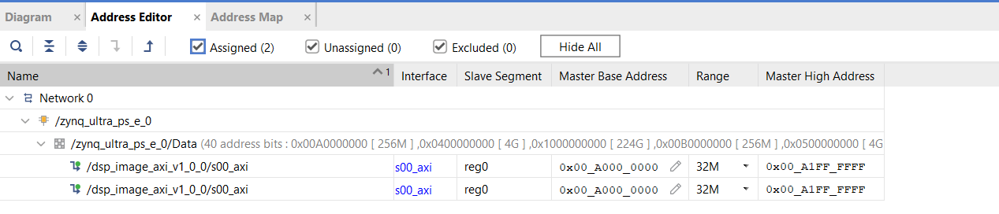
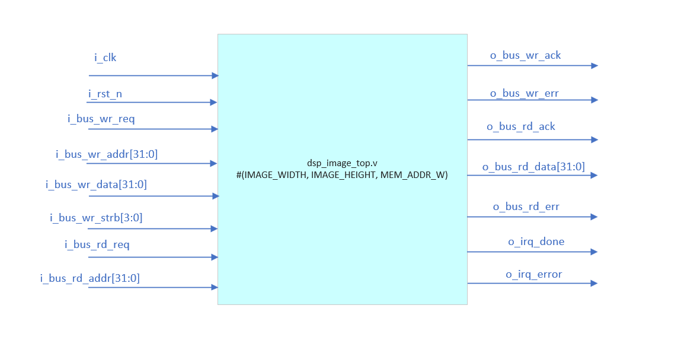
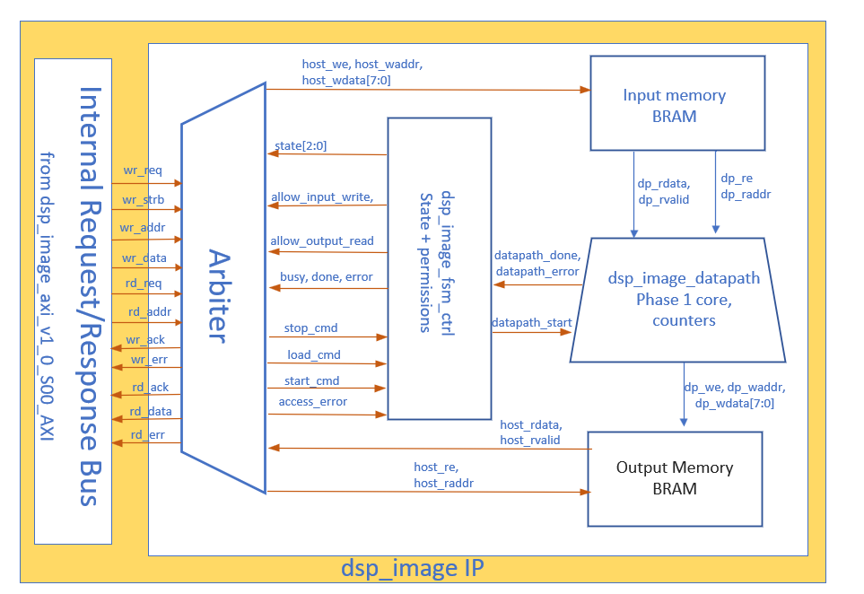
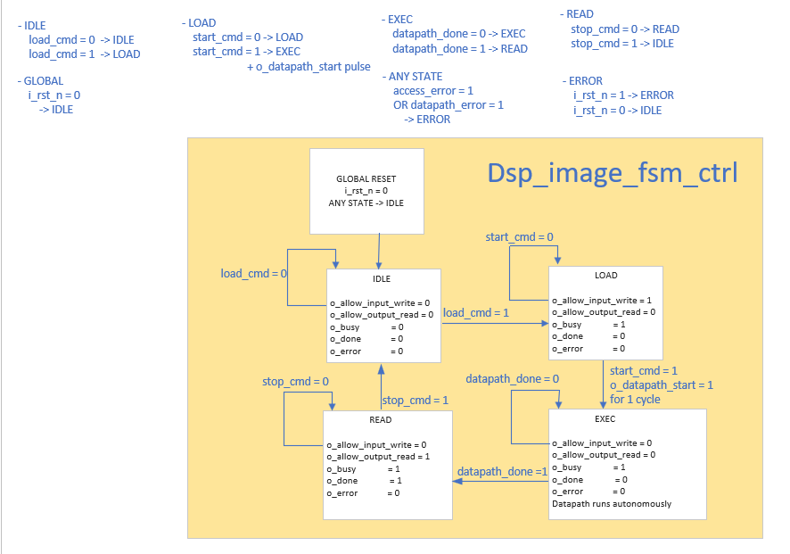

# Embedded DSP Image Processing Benchmark

[](https://en.wikipedia.org/wiki/Verilog)
[](#current-status)
[](#phase-2--axi-memory-mapped-accelerator)
[](#kr260-hardware-status)
[](#license)

A deterministic integer-only image DSP project for **salt-and-pepper noise removal and Sobel edge detection**, implemented with:

- a Python golden model;
- a CPU C baseline (planned);
- synthesizable Verilog-2001 RTL;
- an AXI4-Lite memory-mapped accelerator running on AMD Kria KR260.

The current hardware bring-up target is **AMD Kria KR260 / K26 Zynq UltraScale+ MPSoC** with Ubuntu Linux running on the ARM Processing System (PS).

Final project verification target:

```text
Python == C == FPGA RTL
mismatch = 0
```

Current verified status:

```text
Phase 1 streaming RTL:
Python == RTL
mismatch = 0
PASS

Phase 2 RTL / AXI simulation:
PASS

KR260 physical FPGA:
AXI communication operational
hardware output NOT YET bit-exact
```

---

## DSP Pipeline

```text
RGB Image
   |
   v
Grayscale
   |
   v
Salt & Pepper Noise
   |
   v
Median 3x3
   |
   v
Sobel 3x3
   |
   v
|Gx| + |Gy|
   |
   v
Threshold >= 100
   |
   v
Binary Edge Image
```

Offline preprocessing uses:

```text
Y = (77R + 150G + 29B) >> 8

salt-and-pepper probability = 5%
seed = 12345
```

The final valid output region excludes two pixels on every border:

```text
x = 2 ... W-3
y = 2 ... H-3

N_INPUT  = W * H
N_OUTPUT = (W - 4) * (H - 4)
```

---

# Current Status

## Phase 1 — Verified Streaming DSP Core

**Status: COMPLETE**

The Phase 1 streaming core is the frozen compute reference.

```text
image_dsp_top
│
├── line_buffer #1
├── window_3x3 #1
├── median_3x3
├── line_buffer #2
├── window_3x3 #2
├── sobel_3x3
├── gradient_mag
└── threshold
```

Verified simulation examples:

| Resolution | Inputs | Valid outputs | Result |
|---|---:|---:|---|
| 64x64 | 4096 | 3600 | PASS |
| 512x512 | 262144 | 258064 | PASS |
| 640x480 | 307200 | 302736 | PASS |

The 512x512 baseline produced:

```text
inputs   = 262144
outputs  = 258064
expected = 258064
errors   = 0
PASS
```

Phase 2 may wrap this core but must not silently change its:

- arithmetic;
- coordinate convention;
- border behavior;
- valid-region behavior;
- output raster ordering.

### Phase 1 top-level interface

```text
Inputs
------
i_clk
i_rst                  active-HIGH, Phase 1 local reset only
i_valid
i_pixel[7:0]

Outputs
-------
o_valid
o_pixel[7:0]
o_x[11:0]
o_y[11:0]
o_mag[11:0]
```



---

# Phase 2 — AXI Memory-Mapped Accelerator

**Status: RTL + AXI SIMULATION VERIFIED; KR260 HARDWARE DEBUG IN PROGRESS**

Phase 2 wraps the frozen Phase 1 core with host-controlled input/output memories, an access-control FSM, an arbiter, and an AXI4-Lite protocol wrapper.

```text
dsp_image_axi_v1_0
│
└── dsp_image_axi_v1_0_S00_AXI
    │
    └── dsp_image_top
        ├── dsp_image_arbiter
        ├── dsp_image_fsm_ctrl
        ├── dsp_image_input_memory
        ├── dsp_image_datapath
        │   └── image_dsp_top
        └── dsp_image_output_memory
```

**No DMA is used in the current Phase 2 architecture.**

Raw AXI AW/W/B and AR/R channels terminate in the Vivado AXI wrapper. `dsp_image_top` receives only the internal request/response bus.

---

## System Architecture

```text
Ubuntu Linux / ARM Cortex-A53 PS
              |
              | AXI4-Lite memory-mapped
              v
       AXI Interconnect
              |
              v
    dsp_image_axi_v1_0
              |
              v
       dsp_image_top
```



Current Vivado integration:

```text
design_1_wrapper
└── design_1
    ├── zynq_ultra_ps_e_0
    ├── ps8_0_axi_periph
    ├── rst_ps8_0_99M
    └── dsp_image_axi_v1_0_0
```

### Vivado Block Design

The current KR260 hardware design integrates the Zynq UltraScale+ MPSoC Processing System with the custom Image DSP AXI4-Lite peripheral through the Vivado AXI interconnect.



The implemented block design contains:

```text
zynq_ultra_ps_e_0
ps8_0_axi_periph
rst_ps8_0_99M
dsp_image_axi_v1_0_0
```

The Image DSP accelerator is connected as an AXI4-Lite slave and is controlled by the ARM Processing System.

### Vivado Address Map

The current accelerator is mapped into a 32 MiB physical address aperture.



```text
Base address : 0xA0000000
Range        : 32 MiB
High address : 0xA1FFFFFF
```

This physical mapping is used by the KR260 Linux MMIO debug software through `/dev/mem`.

---

## `dsp_image_top` Interface

Phase 2 custom RTL uses an **active-low synchronous reset**:

```text
i_rst_n = 0  -> reset asserted
i_rst_n = 1  -> normal operation
```

The unchanged Phase 1 core still uses active-high `i_rst`; reset polarity is converted locally inside `dsp_image_datapath`.

```text
dsp_image_top #(
    IMAGE_WIDTH,
    IMAGE_HEIGHT,
    MEM_ADDR_W
)

Inputs
------
i_clk
i_rst_n

i_bus_wr_req
i_bus_wr_addr[31:0]
i_bus_wr_data[31:0]
i_bus_wr_strb[3:0]

i_bus_rd_req
i_bus_rd_addr[31:0]

Outputs
-------
o_bus_wr_ack
o_bus_wr_err

o_bus_rd_ack
o_bus_rd_data[31:0]
o_bus_rd_err

o_irq_done
o_irq_error
```



---

## Internal Control Architecture

The custom accelerator follows strict ownership rules.

```text
FSM
    = defines WHEN an access or operation is legal

Arbiter
    = decodes host transactions
    = enforces FSM permissions
    = produces ACK / ERR

Datapath
    = reads Input Memory during EXEC
    = drives the frozen Phase 1 DSP core
    = writes dense results to Output Memory

Memories
    = passive storage
```



### Internal memory ownership

```text
LOAD:
AXI wrapper
    -> internal request bus
    -> Arbiter
    -> Input Memory write

EXEC:
Datapath
    -> Input Memory read

Datapath
    -> Phase 1 DSP

Datapath
    -> Output Memory write

READ:
Output Memory
    -> Arbiter
    -> internal response bus
    -> AXI wrapper
```

Input and output memories use synchronous registered read behavior.

---

## Phase 2 FSM

Main state flow:

```text
IDLE
  |
  | LOAD command
  v
LOAD
  |
  | START command
  | o_datapath_start pulse
  v
EXEC
  |
  | datapath_done
  v
READ
  |
  | STOP command
  v
IDLE
```

Self-loop behavior:

```text
IDLE:
load_cmd = 0          -> IDLE
load_cmd = 1          -> LOAD

LOAD:
start_cmd = 0         -> LOAD
start_cmd = 1         -> EXEC
                         + o_datapath_start pulse

EXEC:
datapath_done = 0     -> EXEC
datapath_done = 1     -> READ

READ:
stop_cmd = 0          -> READ
stop_cmd = 1          -> IDLE

ERROR:
i_rst_n = 1           -> ERROR
i_rst_n = 0           -> IDLE
```

Error behavior:

```text
ANY STATE:
access_error = 1
OR datapath_error = 1
OR invalid command
    -> ERROR

GLOBAL:
i_rst_n = 0
    -> IDLE
```

FSM state outputs:

| State | Input write allowed | Output read allowed | Busy | Done | Error |
|---|---:|---:|---:|---:|---:|
| IDLE | 0 | 0 | 0 | 0 | 0 |
| LOAD | 1 | 0 | 1 | 0 | 0 |
| EXEC | 0 | 0 | 1 | 0 | 0 |
| READ | 0 | 1 | 1 | 1 | 0 |
| ERROR | 0 | 0 | 0 | 0 | 1 |



The datapath contains a separate internal execution FSM including `ST_PREP`, which applies one full active-high reset cycle to the frozen Phase 1 core before each frame.

---

## AXI4-Lite Mapping

Current AXI characteristics:

```text
AXI data width       = 32 bits
local address width  = 25 bits
IP aperture          = 32 MiB
pixel storage        = one 8-bit pixel per 32-bit address slot
pixel stride         = 4 bytes
DMA                  = not used
```

Input and CTRL writes require:

```text
WSTRB = 4'b0001
```

On the current KR260 Linux path, `main.c` uses aligned `volatile uint8_t` stores for these writes.

### Logical address map

| Offset | Register / Region | Access |
|---:|---|---|
| `0x00000000` | CTRL | R/W command interface |
| `0x00000004` | STATUS | Read |
| `0x00000008` | INFO_WIDTH | Read |
| `0x0000000C` | INFO_HEIGHT | Read |
| `0x00000010` | INFO_THRESHOLD | Read |
| `0x00100000` | INPUT_BASE | Write in LOAD |
| `0x01100000` | OUTPUT_BASE | Read in READ |

Pixel address:

```text
pixel_address = REGION_BASE + 4*k
```

For the current KR260 design:

```text
physical accelerator base = 0xA0000000
physical high address      = 0xA1FFFFFF
```

Therefore:

| Function | Physical address |
|---|---:|
| CTRL | `0xA0000000` |
| STATUS | `0xA0000004` |
| INFO_WIDTH | `0xA0000008` |
| INFO_HEIGHT | `0xA000000C` |
| INFO_THRESHOLD | `0xA0000010` |
| Input pixel region | `0xA0100000` |
| Dense output region | `0xA1100000` |

---

## Dense Output Mapping

FPGA Output Memory stores **only the final valid Sobel region**, densely in raster order.

For dense output index `k`:

```text
x = 2 + (k % (IMAGE_WIDTH - 4))
y = 2 + (k / (IMAGE_WIDTH - 4))
```

The Python `expected.hex` reference is a full `W*H` frame, while FPGA `rtl_output.hex` contains only:

```text
(W - 4) * (H - 4)
```

entries.

Golden comparison therefore uses:

```text
golden_index = y * IMAGE_WIDTH + x
```

---

# Verification

## Phase 2 simulation results

The following tests were completed before board deployment:

| Testbench / Component | Result |
|---|---|
| Input Memory TB | 12434 checks, 0 errors |
| Output Memory TB | 7408 checks, 0 errors |
| Datapath 512x512 | 516133 checks, 0 errors |
| FSM TB | 28 checks, 0 errors |
| Arbiter TB | 40 checks, 0 errors |
| `dsp_image_top` single-frame 512x512 | PASS |
| `dsp_image_top` single-frame 640x480 | PASS |
| `dsp_image_top` multi-frame 512x512 | 2 frames, 0 errors |
| AXI end-to-end multi-frame 64x64 | PASS, 24041 checks, 0 errors |

The AXI regression also verifies:

```text
illegal write
    -> SLVERR
    -> sticky ERROR
    -> active-low reset recovery
```

These are **simulation results** and do not by themselves prove physical FPGA timing or bit-exact board behavior.

---

# KR260 Hardware Status

Current hardware:

```text
Board        : AMD Kria KR260
Device class : K26 Zynq UltraScale+ MPSoC
Vivado       : 2022.2
OS           : Ubuntu Linux on ARM PS
HW frame     : 64x64
Threshold    : 100
```

Confirmed hardware functionality:

```text
FPGA bitstream load     PASS
FPGA manager            operating
INFO register reads     PASS
CTRL.LOAD               PASS
Input MMIO writes       PASS
CTRL.START              PASS
READ/DONE reached       PASS
Output MMIO reads       PASS
CTRL.STOP               PASS
```

Observed status examples:

```text
0x01 = IDLE
0x12 = LOAD + BUSY
0x38 = READ + BUSY + DONE
```

## Current hardware blocker

The FPGA result on the real KR260 is **not yet bit-exact**.

Observed with the same controlled 64x64 input:

```text
Frame 1:
2 mismatches / 3600

Frame 2:
4 mismatches / 3600
```

Persistent mismatch positions:

| Dense k | Coordinate | FPGA | Golden |
|---:|---|---:|---:|
| 2306 | (28,40) | `00` | `FF` |
| 2774 | (16,48) | `00` | `FF` |

Additional mismatches observed in the second sequential frame:

| Dense k | Coordinate | FPGA | Golden |
|---:|---|---:|---:|
| 1948 | (30,34) | `FF` | `00` |
| 2007 | (29,35) | `00` | `FF` |

Therefore:

> **Do not mark KR260 bit-exact verification as PASS until repeated runs reach `mismatch = 0`.**

Immediate debug priorities:

1. save and inspect post-route Timing Summary (`WNS`, `WHS`, unconstrained paths);
2. reproduce the exact board input in XSim;
3. verify the Python golden against the same `noisy.hex`;
4. test deterministic black frames;
5. inspect repeated-frame reset behavior (`ST_PREP`);
6. audit BRAM request/data/valid timing;
7. use ILA if the mismatch persists.

---

## ARM Linux Debug Software

`main.c` is the **KR260 Linux AXI MMIO controller**, not the CPU-only DSP baseline.

It accesses the accelerator through `/dev/mem` and `mmap()`.

Build:

```bash
gcc -O2 -std=c11 -Wall -Wextra main.c -o main
```

Safe debug sequence:

```bash
sudo ./main --log debug.log --probe
sudo ./main --log debug.log --load
sudo ./main --log debug.log --write-frame noisy.hex
sudo ./main --log debug.log --start
sudo ./main --log debug.log --read-frame expected.hex rtl_output.hex
sudo ./main --log debug.log --stop
```

Full workflow, after individual actions are known to be safe:

```bash
sudo ./main --log debug.log --run \
    noisy.hex \
    expected.hex \
    rtl_output.hex
```

---

# Repository Structure

Recommended repository organization:

```text
image-dsp-benchmark/
│
├── README.md
├── project_progress.md
│
├── docs/
│   ├── SPEC_PHASE1.md
│   ├── SPEC_PHASE2.md
│   └── images/
│       ├── image_dsp_pipeline.png
│       ├── dsp_image_top_interface.png
│       ├── kr260_system_architecture.png
│       ├── dsp_image_phase2_architecture.png
│       └── dsp_image_fsm.png
│
├── python/
│   ├── preprocess.py
│   ├── noise.py
│   ├── median.py
│   └── sobel.py
│
├── c/
│   └── ...
│
├── rtl/
│   ├── image_dsp_top.v
│   ├── line_buffer.v
│   ├── window_3x3.v
│   ├── median_3x3.v
│   ├── sobel_3x3.v
│   ├── gradient_mag.v
│   ├── threshold.v
│   ├── dsp_image_top.v
│   ├── dsp_image_arbiter.v
│   ├── dsp_image_fsm_ctrl.v
│   ├── dsp_image_input_memory.v
│   ├── dsp_image_datapath.v
│   └── dsp_image_output_memory.v
│
├── tb/
├── fpga/
│   └── kr260/
├── software/
│   └── kr260/
│       └── main.c
├── data/
└── results/
    └── kr260/
```

---

# Benchmark Targets

The benchmark is intentionally separated into **kernel** and **end-to-end** measurements.

| Case | Platform | Compute | Status |
|---|---|---|---|
| A | KR260 ARM PS | C DSP | Planned |
| B | KR260 FPGA PL | RTL accelerator | Hardware debug |
| C | Orange Pi Zero 3W | Python | Planned |
| D | Orange Pi Zero 3W | C | Planned |

Optional future portability work may target smaller FPGA boards such as EBAZ4205, but it is not the current hardware bring-up platform.

FPGA metrics to report:

```text
kernel cycles
kernel latency
end-to-end latency
FPS
LUT
FF
BRAM
DSP
WNS
WHS
Fmax
```

Do not use userspace MMIO transfer time as a substitute for pure FPGA kernel latency.

---

# Development Roadmap

```text
M1  Python golden model
    [DONE]

        |
        v

M2  Phase 1 streaming RTL
    [DONE]

        |
        v

M3  Phase 2 custom accelerator core
    [DONE IN SIMULATION]

        |
        v

M4  AXI4-Lite wrapper + AXI regression
    [DONE IN SIMULATION]

        |
        v

M5  Vivado IP packaging + KR260 integration
    [DONE]

        |
        v

M6  ARM Linux MMIO control
    [DONE AT INTERFACE LEVEL]

        |
        v

M7  KR260 bit-exact + repeated-frame determinism
    [CURRENT / BLOCKED]

        |
        v

M8  Timing + utilization characterization
    [PENDING REPORTS]

        |
        v

M9  CPU-only C DSP baseline
    [PLANNED]

        |
        v

M10 CPU vs FPGA benchmark
    [PLANNED]

        |
        v

M11 Orange Pi / Web demonstration
    [PLANNED]
```

---

# Documentation

- [`docs/SPEC_PHASE1.md`](docs/SPEC_PHASE1.md) — frozen Phase 1 algorithm and RTL contract
- [`docs/SPEC_PHASE2.md`](docs/SPEC_PHASE2.md) — strict Phase 2 accelerator contract
- [`project_progress.md`](project_progress.md) — current engineering handoff and hardware debug status
- [`python/README.md`](python/README.md) — Python golden-model and verification workflow
- `software/kr260/main.c` — ARM Linux AXI MMIO debug/controller program

---

# Engineering Rules

1. Phase 1 arithmetic and border behavior are frozen unless the specification is intentionally revised.
2. Phase 2 custom RTL uses active-low `i_rst_n`; the Phase 1 core alone uses active-high `i_rst`.
3. Raw AXI protocol logic remains inside the Vivado-generated AXI wrapper.
4. The Arbiter owns host transaction decode and access enforcement.
5. The FSM owns legal state transitions.
6. The Datapath owns EXEC-side memory access and image processing.
7. Output Memory stores only dense valid-region results.
8. Pixel writes require `WSTRB = 4'b0001`.
9. Simulation PASS does not imply physical timing closure.
10. KR260 hardware verification is complete only after repeated identical frames produce `mismatch = 0`.

---

# License

MIT License.
