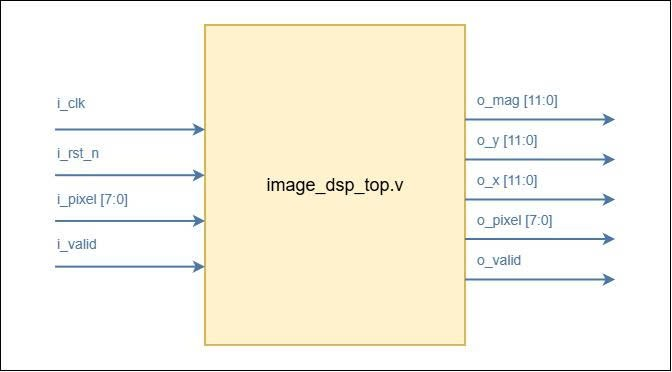

# Embedded DSP Image Processing Benchmark

[](https://en.wikipedia.org/wiki/Verilog)
[](#current-status)
[](#phase-2--structured-accelerator)
[](#license)

A classical integer-only image-processing project for **salt-and-pepper noise removal and Sobel edge detection**, implemented as a software reference model and synthesizable FPGA RTL.

The project targets:

- **Orange Pi Zero 3W** — CPU baseline and web demonstration
- **EBAZ4205 / Zynq-7010** — ARM PS + FPGA PL
- **AMD Kria KR260** — ARM PS + FPGA PL

Final verification target:

```text
Python == C == RTL
mismatch = 0
```

Current verified RTL status:

```text
Python == RTL
mismatch = 0
PASS
```

---

## DSP Pipeline

```text
Original RGB Image
        |
        v
    Grayscale
        |
        v
Salt & Pepper Noise
        |
        v
   Median 3x3
        |
        v
    Sobel 3x3
      |     |
      v     v
     Gx     Gy
       \   /
         v
    |Gx| + |Gy|
         |
         v
    Threshold
         |
         v
 Binary Edge Image
```

The RTL uses integer arithmetic only.

---

## Current Status

### Phase 1 — Verified Streaming DSP Core

**Status: COMPLETE**

The standalone RTL pipeline has been implemented and verified against the Python golden model.

```text
W=512 H=512
outputs=258064
expected=258064
errors=0
PASS
```

Verified result:

```text
Python == RTL
mismatch = 0
```

Phase 1 datapath:

```text
image_dsp_top
│
├── line_buffer #1
├── window_3x3 #1
├── median_3x3
├── line_buffer #2
├── window_3x3 #2
├── sobel_3x3
├── gradient_mag
└── threshold
```

The Phase 1 core is now treated as a **frozen verified compute block**.

---

## Phase 2 — Structured Accelerator

**Status: CURRENT**

Phase 2 wraps the verified DSP core with a structured accelerator architecture.

```text
                    Host / Future AXI
                           |
                           v
                     +-----------+
                     |  Arbiter  |
                     +-----------+
                           |
                           v
                     +-----------+
                     | FSM_CTRL  |
                     +-----------+
                       |       |
                       v       v
                  +--------+ +--------+
                  | Input  | | Output |
                  | Buffer | | Buffer |
                  +--------+ +--------+
                       |       ^
                       v       |
                  +----------------+
                  |   Datapath     |
                  | Verified Core  |
                  +----------------+
```

Block responsibilities:

```text
Arbiter
    = command authority and high-level ownership

FSM Controller
    = execution sequencing and frame lifecycle

Input / Output
    = data transport and buffering

Datapath
    = verified Median + Sobel processing core
```

Recommended FSM flow:

```text
IDLE
  |
  v
LOAD
  |
  v
WORK
  |
  v
DRAIN
  |
  v
DONE
```

Detailed Phase 2 interfaces, signals, state behavior, handshakes, and verification rules are defined in:

[`docs/SPEC_PHASE2.md`](docs/SPEC_PHASE2.md)

---

## RTL Architecture

### Phase 1 Top-Level Interface

```text
Inputs
------
i_clk
i_rst
i_valid
i_pixel[7:0]

Outputs
-------
o_valid
o_pixel[7:0]
o_x[11:0]
o_y[11:0]
o_mag[11:0]
```



### Internal DSP Pipeline


Coordinates and valid timing are propagated alongside the pixel stream so that
the final output remains spatially aligned with the source image.

---

## Repository Structure

```text
image-dsp-benchmark/
│
├── README.md
│
├── docs/
│   ├── SPEC_PHASE1.md
│   ├── SPEC_PHASE2.md
│   └── images/
│
├── python/
│
├── c/
│
├── rtl/
│
├── tb/
│
├── fpga/
│   ├── ebaz/
│   └── kr260/
│
└── results/
```

### Folder Responsibilities

| Folder | Purpose |
| --- | --- |
| `docs/` | Technical specifications and architecture documentation for each development phase |
| `docs/images/` | RTL schematics, block diagrams, and documentation figures |
| `python/` | Official software golden model, image preprocessing, reference DSP algorithms, verification utilities, and HEX/image conversion tools |
| `c/` | CPU implementation used for software acceleration experiments and CPU-vs-FPGA benchmarking |
| `rtl/` | Synthesizable Verilog-2001 implementation of the DSP pipeline and Phase 2 accelerator modules |
| `tb/` | RTL simulation testbenches, golden-vector loading, output checking, and regression tests |
| `fpga/` | Board-specific Vivado integration, constraints, synthesis, implementation, and hardware deployment files |
| `fpga/ebaz/` | EBAZ4205 / Zynq-7010 implementation files |
| `fpga/kr260/` | AMD Kria KR260 implementation files |
| `results/` | Golden outputs, RTL results, converted images, benchmark tables, and performance plots |

The Python execution guide is kept separately in:

[`python/README.md`](python/README.md)

---

## Verification

The project follows golden-model-driven verification.

```text
Python Golden Model
        |
        +--------------------+
        |                    |
        v                    v
    C Output             RTL Output
        |                    |
        +---------+----------+
                  |
                  v
              Compare
```

Verification requirements:

- Python vs RTL mismatch = 0
- Python vs C mismatch = 0
- final target: `Python == C == RTL`
- non-square images must be supported
- final valid output count must be:

```text
(W - 4) * (H - 4)
```

Examples:

| Resolution | Valid outputs |
| --- | ---: |
| 64x64 | 3600 |
| 512x512 | 258064 |
| 640x480 | 302736 |

Phase 1 is already verified.

Phase 2 must preserve the same bit-exact output.

---

## Benchmark Targets

| Case | Board | Compute | Implementation |
| --- | --- | --- | --- |
| A | Orange Pi Zero 3W | CPU | Python |
| B | Orange Pi Zero 3W | CPU | C |
| C | EBAZ4205 | ARM PS | C |
| D | KR260 | ARM PS | C |
| E | EBAZ4205 | FPGA PL | RTL Accelerator |
| F | KR260 | FPGA PL | RTL Accelerator |

### CPU Metrics

- Median latency
- Sobel latency
- total DSP latency
- FPS
- CPU utilization
- RAM usage

### FPGA Metrics

- kernel latency
- end-to-end latency
- FPS
- LUT
- FF
- BRAM
- DSP
- Fmax

---

## Development Roadmap

```text
Phase 1
Standalone Verified DSP Core
[DONE]

        |
        v

Phase 2
Arbiter + FSM + Input/Output + Datapath
[CURRENT]

        |
        v

Phase 3
AXI / PS-PL Integration

        |
        v

Phase 4
CPU vs FPGA Benchmark

        |
        v

Phase 5
Web Demonstration
```

---

## Documentation

### Phase 1 Specification

[`docs/SPEC_PHASE1.md`](docs/SPEC_PHASE1.md)

Defines:

- DSP algorithms
- datatype rules
- coordinate convention
- border and valid-region rules
- streaming RTL behavior
- module interfaces
- latency budget
- Phase 1 verification contract

### Phase 2 Specification

[`docs/SPEC_PHASE2.md`](docs/SPEC_PHASE2.md)

Defines:

- Arbiter behavior
- FSM architecture
- Input / Output buffering
- verified Datapath wrapper
- module interfaces
- signal definitions
- handshake rules
- state transitions
- error handling
- synthesis requirements
- Phase 2 verification plan
- future AXI integration

### Python Usage

[`python/README.md`](python/README.md)

Contains the commands for:

- generating golden data
- selecting image resolution
- verifying RTL output
- converting `.hex` files to `.png`

---

## Contributing

This repository uses Conventional Commits.

Examples:

```text
feat(rtl): add median 3x3 compare-swap network
feat(accel): add image DSP FSM controller
test(accel): add accelerator regression test
docs: update Phase 2 architecture
```

---

## License

MIT License.
